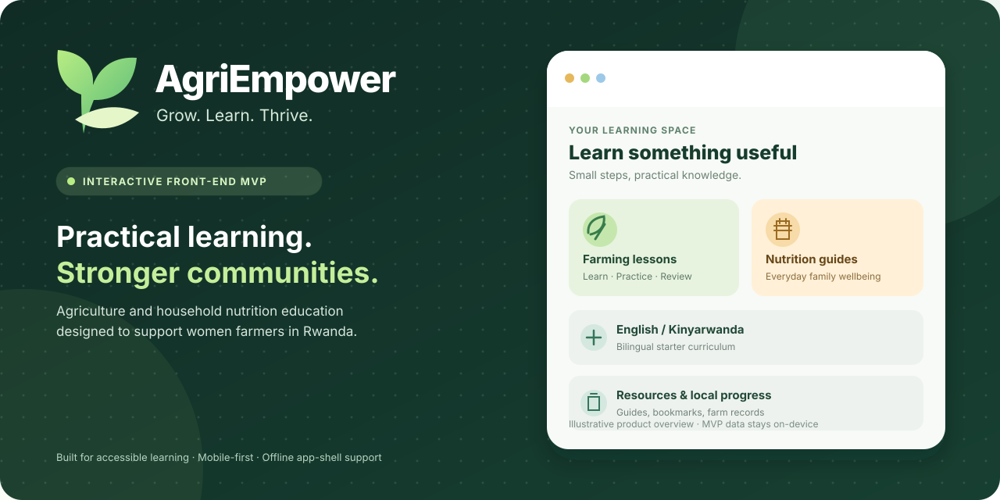

# AgriEmpower

**Grow. Learn. Thrive.**



*An illustrative overview of the current interactive front-end MVP. Progress and farm records are stored on the current device; this is not a live service or verified impact program.*

AgriEmpower is a responsive, installable, bilingual (English / Kinyarwanda starter copy) learning platform intended to support women farmers in Rwanda. It introduces accessible agricultural practices, household nutrition education, practical planning resources, and tools for tracking learning and farm activity.

> **Project status: interactive front-end MVP.** Learning progress, bookmarks, discussions, mentoring interests, and farm records are saved **only on the current device**. There is no account system, online forum, mentor matching network, verified agent booking, backend, or live impact database yet. Never present the demo as an operational service or verified impact program.

## Included features

| Area | Working MVP functionality | Later production integration |
| --- | --- | --- |
| Education | 8 short interactive farming and nutrition lessons with knowledge checks, optional speech playback, and completion tracking | Expert-reviewed multimedia and formal curricula |
| Localization | English / Kinyarwanda language switch and translated starter curriculum | Community-reviewed translation, accessible audio and regional languages |
| Resources | Searchable guides, printable checklists, CSV farm planning templates and seasonal planting-plan sheet, bookmarks, vetted public resource links | Downloaded media, translated PDF toolkits, localized planting calendars |
| Community | Topic-based discussion drafts and replies saved on the device | Secure multi-user posts, moderation, anti-abuse safeguards |
| Mentorship | Interest and support-request drafts saved locally | Verified mentors, consent, partner referrals and messaging |
| Impact | Harvest kilograms, food-availability and vegetable-meal day records; chart, milestones, CSV/JSON export | Secure longitudinal reporting with careful indicators and consent |
| Offline | Service-worker app-shell caching after an online first visit | Offline translations, video packages and robust sync |

## Quick start

The site is built with native HTML, CSS and JavaScript modules. **No npm dependencies or API keys are needed.** Node.js 20+ is recommended for the local development server, tests and build script.

```bash
# Clone this repository and enter it.
git clone https://github.com/samertall/AgriEmpower.git
cd AgriEmpower

# Start the development web server.
npm run dev

# Visit http://localhost:4173
```

You can also host the files with any local static file server. Do not open `index.html` with `file://` because module imports and the offline service worker require HTTP(S).

## Run checks and build

```bash
npm test
npm run build
```

`npm run build` creates `dist/`, a dependency-free static site ready for deployment.

## Publish on GitHub Pages

1. This repository is named `AgriEmpower` and is public.
2. The project includes the `.github/workflows/deploy.yml` workflow to test, build and publish after pushes to `main`.
3. In GitHub, open **Settings > Pages > Build and deployment > Source**, then choose **GitHub Actions**.
4. Find the deployed URL under **Settings > Pages** after the workflow succeeds.

This project uses relative asset URLs and `#/page` routes so it works in GitHub Pages subfolders without special routing configuration.

## Project structure

```text
AgriEmpower/
  .github/workflows/deploy.yml   # test + deploy to GitHub Pages
  assets/                        # illustrations, install icons and README overview
  scripts/build.mjs              # builds /dist without third-party tools
  scripts/dev.mjs                # local HTTP server
  src/app.js                     # routing, views, interactions and forms
  src/data.js                    # starter lesson/resource content
  src/i18n.js                    # interface English/Kinyarwanda translations
  src/icons.js                   # local SVG icons
  src/storage.js                 # isolated localStorage access
  src/utils.js                   # escaping, validation, CSV and routing
  tests/utils.test.mjs           # Node unit tests
  index.html                     # app entry point
  styles.css                     # responsive design system
  sw.js                          # offline app-shell caching
  manifest.webmanifest           # installable-app configuration
  CONTRIBUTING.md
  PRIVACY.md
  LICENSE
```

## Accessibility and field deployment

- Designed mobile-first with readable typography, large tap targets, semantic controls, keyboard navigation, visible focus, and reduced-motion support.
- Works after first visit offline for the app shell and included lessons. **External FAO/RAB/WHO links, Google Fonts and speech services may need connectivity.** Device text-to-speech support, especially for Kinyarwanda, varies by operating system; do not rely on audio alone.
- All curriculum, translated text, and illustrations are **starter assets**. Before deployment with participants, have Rwanda-based women farmers, extension workers, child-nutrition specialists, and qualified Kinyarwanda translators review clarity, accuracy, tone and local relevance.
- Do not use the seven-day household food questions as a diagnostic tool. Avoid storing identifying or sensitive health information without an appropriately designed consent and security model.
- The interface uses externally hosted optional web fonts; system fonts remain available when offline.
- Users should be warned that browser storage can be cleared and that shared devices may expose locally stored records. A JSON export and local-data deletion control are provided in Support.

## Trusted external educational references

AgriEmpower's external reference cards point to publicly accessible resources. Inclusion **does not imply endorsement or a partnership**.

- [Rwanda Agriculture and Animal Resources Development Board (RAB)](https://www.rab.gov.rw/)
- [FAO: Food Plants for Healthy Diets in Rwanda](https://www.fao.org/family-farming/detail/en/c/1604576/)
- [FAO: Healthy eating educational resources](https://www.fao.org/nutrition/education/healthy-eating-resources)
- [WHO: Complementary feeding](https://www.who.int/health-topics/complementary-feeding)
- [FAO: Farmer Field School videos](https://www.fao.org/farmer-field-schools/resources/videos/en)

## Production roadmap

1. **Validate the curriculum in Rwanda:** participatory research, literacy testing, Kinyarwanda translation QA, localized calendars and field-worker review.
2. **Secure authentication and consent:** opt-in profiles, roles, encryption in transit, access control, data retention and deletion, and a defensible privacy policy.
3. **Real community and mentors:** database/API, content moderation, reporting/blocking, mentor verification, safeguards, notifications and referral operations.
4. **Richer educational delivery:** captions, audio recordings in local languages, low-bandwidth video, content versioning and accessible downloadable guides.
5. **Meaningful impact research:** consented longitudinal metrics, baselines, validation, disaggregation, program evaluation and honest outcomes reporting.
6. **Operational partnerships:** verify any field agent and NGO/government relationship before showing it as active.

## How to contribute

Please read [CONTRIBUTING.md](CONTRIBUTING.md). Contributions to UX, translation, educational accuracy, security, documentation and development are welcome.

## License

MIT. See [LICENSE](LICENSE). The project's educational summaries are starter original content; linked third-party works retain their own licenses and should not be copied into the repository without permission.
